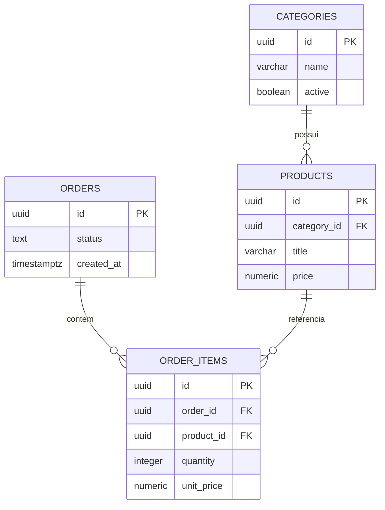

# Restaurant Ordering System API

API REST desenvolvida para administrar o catálogo e o fluxo de pedidos de um
restaurante. A aplicação permite cadastrar categorias e produtos, abrir pedidos,
adicionar itens, calcular o total e controlar as etapas de preparo.

Este projeto é a evolução do trabalho do primeiro bimestre da disciplina de
Desenvolvimento Back-End do curso de Engenharia de Software.

## Integrante

- Felipe Santos
- Lucas William

## Tecnologias

- Node.js 24
- TypeScript
- Express 5
- Supabase/PostgreSQL
- Vitest e V8 Coverage
- Supertest
- Swagger/OpenAPI 3
- GitHub Actions

## Entidades e relacionamentos

| Entidade | Principais atributos | Relacionamento |
|---|---|---|
| `Category` | `id`, `name`, `description`, `icon`, `display_order`, `active` | Uma categoria possui vários produtos |
| `Product` | `id`, `category_id`, `title`, `price`, `available`, `active` | Um produto pertence a uma categoria e pode aparecer em vários itens |
| `Order` | `id`, `status`, `created_at` | Um pedido possui vários itens |
| `OrderItem` | `id`, `order_id`, `product_id`, `quantity`, `unit_price` | Pertence a um pedido e referencia um produto |

Todos os identificadores são UUID. As chaves estrangeiras garantem a integridade
dos relacionamentos entre categorias, produtos, pedidos e seus itens. O banco
rejeita a exclusão de registros que ainda estejam referenciados por outra tabela.

## Regras de negócio

- O nome da categoria é obrigatório e não pode ser duplicado.
- A ordem de exibição da categoria deve ser um número inteiro não negativo.
- Um produto só pode ser vinculado a uma categoria existente e ativa.
- O título do produto é obrigatório e o preço não pode ser negativo.
- Todo pedido é criado com o status `pending`.
- As transições válidas são:
  - `pending` → `preparing` ou `cancelled`;
  - `preparing` → `ready` ou `cancelled`;
  - `ready` → `delivered`.
- Pedidos entregues não podem ser excluídos.
- Itens só podem ser incluídos, alterados ou removidos enquanto o pedido estiver
  pendente.
- Produtos inativos ou indisponíveis não podem ser adicionados a pedidos.
- A quantidade deve ser um número inteiro positivo.
- O preço do produto é copiado para `unit_price` no momento da inclusão do item,
  preservando o valor histórico do pedido.
- O total é calculado pela soma de `quantity × unit_price`.

## Arquitetura

```text
src/
├── config/          # Supabase e contrato OpenAPI
├── controller/      # Entrada e saída HTTP
├── errors/          # Erros de domínio padronizados
├── middleware/      # Tratamento central de erros e rotas inexistentes
├── model/           # Classes, encapsulamento e validações de domínio
├── repositories/    # Persistência no Supabase/PostgreSQL
├── routes/          # Endpoints Express
├── services/        # Casos de uso e regras de negócio
├── tests/
│   ├── helpers/     # Adaptadores em memória para testes reproduzíveis
│   ├── integration/ # Testes HTTP com Supertest
│   └── unit/        # Testes de Models e Services
├── utils/           # Validadores reutilizáveis
├── app.ts           # Configuração da aplicação
└── server.ts        # Inicialização do servidor

database/
└── schema.sql       # Estrutura reproduzível do PostgreSQL

docs/
├── coverage-summary.md # Resumo da cobertura de testes
└── database.md         # Tabelas, relacionamentos e SQL de criação
```

Os Controllers tratam o protocolo HTTP, os Services concentram regras de
negócio, os Models representam o domínio e os Repositories são responsáveis
exclusivamente pelo acesso aos dados.

## Configuração

### Pré-requisitos

- Node.js 24 ou superior;
- npm;
- projeto criado no Supabase.

### Instalação

```bash
git clone https://github.com/oofelipesantos/restaurant_ordering_system_sjp.git
cd restaurant_ordering_system_sjp
npm install
```

Crie o arquivo `.env` a partir do exemplo:

```bash
cp .env.example .env
```

Configure as variáveis:

```env
SUPABASE_URL=https://seu-projeto.supabase.co
SUPABASE_SECRET_KEY=sua-chave-secreta-do-supabase
PORT=3000
```

`SUPABASE_SECRET_KEY` é uma credencial somente de servidor. Ela nunca deve ser
enviada ao Front-end, publicada no GitHub ou compartilhada em capturas de tela.

### Banco de dados

A persistência da API utiliza **PostgreSQL**, hospedado no **Supabase**. O modelo
relacional separa o cardápio do fluxo de pedidos e mantém a integridade dos dados
por meio de chaves primárias UUID, chaves estrangeiras e restrições `CHECK`.

#### Visão relacional



#### Arquivos do banco

| Recurso | Conteúdo |
|---|---|
| [Estrutura completa](docs/database.md) | Colunas, tipos, restrições, relacionamentos e comandos `CREATE TABLE` |
| [Script SQL](database/schema.sql) | Arquivo pronto para criar as quatro tabelas no Supabase |

#### Criando as tabelas

1. Abra o **SQL Editor** no painel do Supabase.
2. Copie o conteúdo de [`database/schema.sql`](database/schema.sql).
3. Execute o script e confirme a criação de `categories`, `products`, `orders` e
   `order_items`.

### Execução

```bash
npm run dev
```

A API será iniciada em `http://localhost:3000`.

Para gerar e executar a versão compilada:

```bash
npm run build
npm start
```

## Endpoints

### Categorias

| Método | Endpoint | Finalidade |
|---|---|---|
| GET | `/categories` | Listar categorias |
| GET | `/categories/search?keyword=pizza` | Pesquisar por nome ou descrição |
| GET | `/categories/:id` | Consultar por UUID |
| POST | `/categories` | Criar categoria |
| PUT | `/categories/:id` | Atualizar categoria |
| DELETE | `/categories/:id` | Excluir categoria |

### Produtos

| Método | Endpoint | Finalidade |
|---|---|---|
| GET | `/products` | Listar produtos |
| GET | `/products/search?keyword=pizza` | Pesquisar por título ou descrição |
| GET | `/products/:id` | Consultar por UUID |
| POST | `/products` | Criar produto |
| PUT | `/products/:id` | Atualizar produto |
| DELETE | `/products/:id` | Excluir produto |

### Pedidos

| Método | Endpoint | Finalidade |
|---|---|---|
| GET | `/orders` | Listar pedidos |
| GET | `/orders/:id` | Consultar pedido, itens e total |
| POST | `/orders` | Criar pedido pendente |
| PUT | `/orders/:id` | Alterar o status |
| DELETE | `/orders/:id` | Excluir pedido permitido |

### Itens de pedido

| Método | Endpoint | Finalidade |
|---|---|---|
| GET | `/order-items` | Listar todos os itens |
| GET | `/order-items?order_id=:orderId` | Listar itens de um pedido |
| GET | `/order-items/:id` | Consultar item por UUID |
| POST | `/order-items` | Adicionar produto ao pedido |
| PUT | `/order-items/:id` | Alterar quantidade |
| DELETE | `/order-items/:id` | Excluir item |

### Rotas auxiliares

| Método | Endpoint | Finalidade |
|---|---|---|
| GET | `/health` | Verificar disponibilidade da aplicação |
| GET | `/api-docs` | Abrir a documentação Swagger |
| GET | `/openapi.json` | Obter o contrato OpenAPI em JSON |

## Exemplos de requisições

Criar categoria:

```json
{
  "name": "Pizzas",
  "description": "Pizzas tradicionais e especiais",
  "icon": "🍕",
  "display_order": 1
}
```

Criar produto:

```json
{
  "category_id": "UUID_DA_CATEGORIA",
  "title": "Pizza Margherita",
  "description": "Molho, mussarela e manjericão",
  "price": 39.90
}
```

Criar pedido: `POST /orders` sem corpo.

Adicionar item:

```json
{
  "order_id": "UUID_DO_PEDIDO",
  "product_id": "UUID_DO_PRODUTO",
  "quantity": 2
}
```

Atualizar status:

```json
{
  "status": "preparing"
}
```

## Testes automatizados

Os testes unitários verificam Models, Services, validações e regras de negócio.
Os testes de integração iniciam a aplicação Express e exercitam os endpoints com
Supertest. Repositórios em memória isolam cada cenário, permitem repetição sem
efeitos colaterais e evitam alterações no banco real.

```bash
npm test                 # Todos os testes
npm run test:unit        # Somente testes unitários
npm run test:integration # Somente testes de integração
npm run test:coverage    # Testes e relatório de cobertura
```

Último resultado verificado: 29 testes aprovados em 7 arquivos.

| Métrica | Resultado | Exigência |
|---|---:|---:|
| Statements | 73,84% | 60% |
| Branches | 61,72% | 60% |
| Functions | 80,43% | 60% |
| Lines | 75,50% | 60% |

O resumo versionado está em
[`docs/coverage-summary.md`](docs/coverage-summary.md). O relatório HTML é gerado
em `coverage/index.html`.

## Swagger/OpenAPI

Com a aplicação em execução, acesse:

```text
http://localhost:3000/api-docs
```

A interface permite consultar métodos, parâmetros, exemplos, schemas e códigos
de resposta de todos os endpoints das quatro entidades.

## Códigos HTTP

- `200`: consulta, atualização ou exclusão concluída;
- `201`: registro criado;
- `400`: dados ou transição inválida;
- `404`: registro ou rota não encontrada;
- `409`: conflito de unicidade, relacionamento ou regra de negócio;
- `500`: erro interno ou falha de configuração.

## Integração contínua

O workflow `.github/workflows/ci.yml` executa automaticamente:

1. instalação reproduzível com `npm ci`;
2. compilação TypeScript;
3. testes automatizados;
4. validação dos quatro limites mínimos de cobertura.

## Segurança

- `.env` e credenciais reais são ignorados pelo Git;
- apenas `.env.example` é versionado;
- a chave secreta do Supabase é utilizada somente no Back-end;
- erros internos não são devolvidos ao cliente;
- dados recebidos são validados antes da persistência;
- RLS e suas policies devem ser configuradas no Supabase conforme o ambiente.
