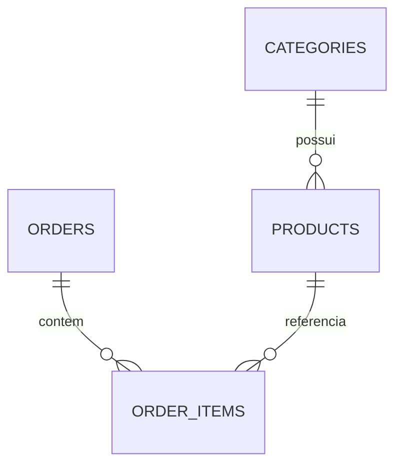

# Estrutura do banco de dados

O projeto utiliza PostgreSQL hospedado no Supabase. O banco é composto pelas
tabelas `categories`, `products`, `orders` e `order_items`.

## Relacionamentos



- Uma categoria pode possuir vários produtos.
- Um pedido pode possuir vários itens.
- Cada item referencia um produto e registra seu preço no momento da inclusão.

## Tabela `categories`

Armazena as categorias usadas para organizar o cardápio.

| Coluna | Tipo | Restrições e valor padrão |
|---|---|---|
| `id` | `uuid` | Chave primária, `NOT NULL`, padrão `gen_random_uuid()` |
| `name` | `varchar` | `NOT NULL` |
| `description` | `varchar` | Aceita `NULL` |
| `icon` | `varchar` | Aceita `NULL` |
| `display_order` | `integer` | `NOT NULL` |
| `active` | `boolean` | `NOT NULL`, padrão `true` |
| `created_at` | `timestamptz` | Aceita `NULL`, padrão `now()` |
| `updated_at` | `timestamptz` | Aceita `NULL`, padrão `now()` |

## Tabela `products`

Armazena os produtos do cardápio e sua categoria.

| Coluna | Tipo | Restrições e valor padrão |
|---|---|---|
| `id` | `uuid` | Chave primária, `NOT NULL`, padrão `gen_random_uuid()` |
| `category_id` | `uuid` | `NOT NULL`, chave estrangeira para `categories(id)` |
| `title` | `varchar` | `NOT NULL` |
| `description` | `varchar` | Aceita `NULL` |
| `price` | `numeric` | `NOT NULL` |
| `image` | `varchar` | Aceita `NULL` |
| `available` | `boolean` | `NOT NULL`, padrão `true` |
| `active` | `boolean` | `NOT NULL`, padrão `true` |
| `created_at` | `timestamptz` | Aceita `NULL`, padrão `now()` |
| `updated_at` | `timestamptz` | Aceita `NULL`, padrão `now()` |

## Tabela `orders`

Armazena os pedidos e a etapa atual de atendimento.

| Coluna | Tipo | Restrições e valor padrão |
|---|---|---|
| `id` | `uuid` | Chave primária, `NOT NULL`, padrão `gen_random_uuid()` |
| `status` | `text` | `NOT NULL`, padrão `pending`, limitado aos estados válidos |
| `created_at` | `timestamptz` | Aceita `NULL`, padrão `now()` |

O `CHECK` de `status` permite somente `pending`, `preparing`, `ready`,
`delivered` ou `cancelled`.

## Tabela `order_items`

Representa os produtos adicionados a cada pedido.

| Coluna | Tipo | Restrições e valor padrão |
|---|---|---|
| `id` | `uuid` | Chave primária, `NOT NULL`, padrão `gen_random_uuid()` |
| `order_id` | `uuid` | `NOT NULL`, chave estrangeira para `orders(id)` |
| `product_id` | `uuid` | `NOT NULL`, chave estrangeira para `products(id)` |
| `quantity` | `integer` | `NOT NULL`, deve ser maior que zero |
| `unit_price` | `numeric` | `NOT NULL`, deve ser maior ou igual a zero |

O campo `unit_price` guarda uma cópia do preço do produto no momento da inclusão.
Assim, uma alteração posterior no preço do cardápio não modifica o valor histórico
do pedido.

## SQL de criação

```sql
create extension if not exists pgcrypto;

create table if not exists public.categories (
    id uuid not null default gen_random_uuid(),
    name character varying not null,
    description character varying,
    icon character varying,
    display_order integer not null,
    active boolean not null default true,
    created_at timestamp with time zone default now(),
    updated_at timestamp with time zone default now(),
    constraint categories_pkey primary key (id)
);

create table if not exists public.products (
    id uuid not null default gen_random_uuid(),
    category_id uuid not null,
    title character varying not null,
    description character varying,
    price numeric not null,
    image character varying,
    available boolean not null default true,
    active boolean not null default true,
    created_at timestamp with time zone default now(),
    updated_at timestamp with time zone default now(),
    constraint products_pkey primary key (id),
    constraint fk_products_category
        foreign key (category_id) references public.categories(id)
);

create table if not exists public.orders (
    id uuid not null default gen_random_uuid(),
    status text not null default 'pending'
        check (status in ('pending', 'preparing', 'ready', 'delivered', 'cancelled')),
    created_at timestamp with time zone default now(),
    constraint orders_pkey primary key (id)
);

create table if not exists public.order_items (
    id uuid not null default gen_random_uuid(),
    order_id uuid not null,
    product_id uuid not null,
    quantity integer not null check (quantity > 0),
    unit_price numeric not null check (unit_price >= 0),
    constraint order_items_pkey primary key (id),
    constraint order_items_order_id_fkey
        foreign key (order_id) references public.orders(id),
    constraint order_items_product_id_fkey
        foreign key (product_id) references public.products(id)
);
```

O mesmo script está disponível em [`database/schema.sql`](../database/schema.sql)
para execução direta no SQL Editor do Supabase. A configuração de RLS e de suas
policies é feita separadamente no painel, de acordo com o ambiente.
